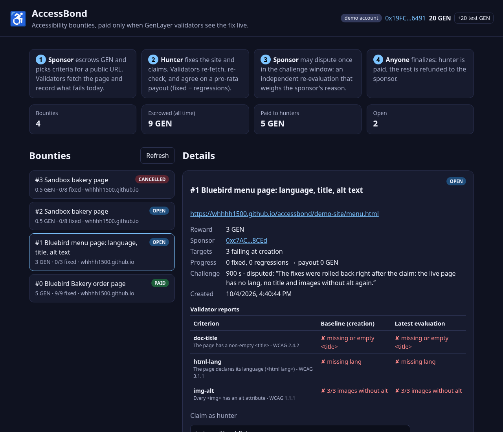
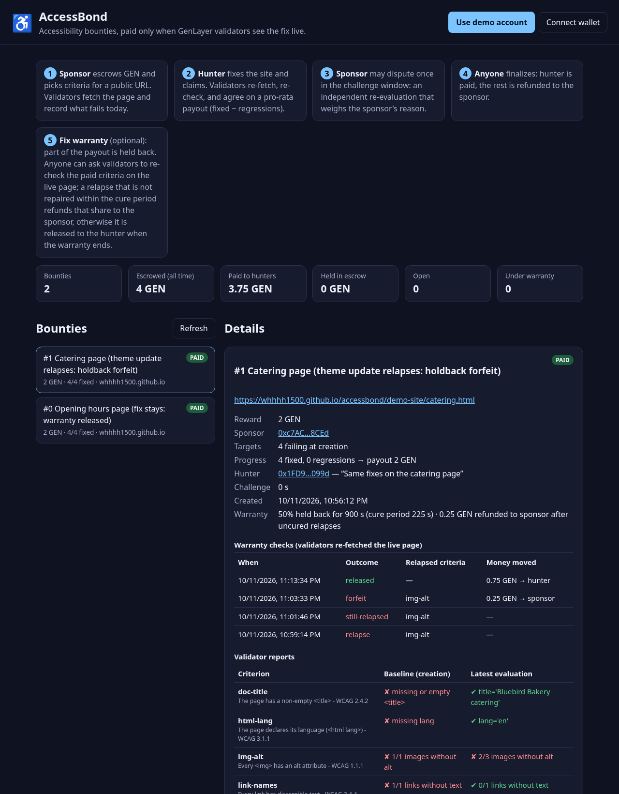
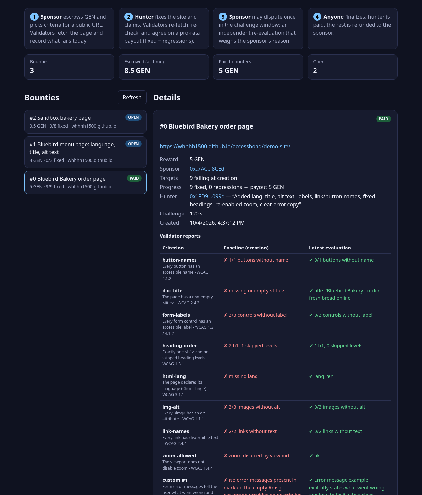

# AccessBond

**Accessibility bounties that pay out only when GenLayer validators see the fix on the live site.**

A sponsor escrows GEN against "make this public page meet these accessibility criteria".
GenLayer validators fetch the page, record what fails today, and later independently
re-check the live site when a hunter claims the fix. They then agree on a pro-rata payout.
The sponsor gets one dispute (appeal) during a challenge window. Nobody has to trust
the sponsor, the hunter, or a single auditor.

**v0.2: fix warranty.** Paid accessibility fixes regress: a theme update, a plugin or a batch of
unlabeled product photos brings the same failures back, and repeat lawsuits target exactly those
sites. A sponsor can now hold back part of the payout for a warranty period. Anyone can ask the
validators to re-check the paid criteria on the live page. A relapse that is not repaired within a
cure period refunds that share to the sponsor; otherwise it is released to the hunter. See
[Fix warranty](#fix-warranty-v02).

- **Live app:** https://whhhh1500.github.io/accessbond/ (GenLayer Studio. Click *Use demo account* to get a funded burner wallet, or connect a browser wallet.)
- **Contract v0.2 (studionet):** [`0x8Ca1DF2eAc0890Edc819796C9cC8489802608923`](https://explorer-studio.genlayer.com/address/0x8Ca1DF2eAc0890Edc819796C9cC8489802608923) (v0.1: `0x86573EFC…8BfB`, see `deployments/studionet.json`)
- **Demo target site:** https://whhhh1500.github.io/accessbond/demo-site/ (a small bakery page that was broken, then fixed, during the recorded run below)



## Why this needs GenLayer

The judgment is *about the outside world* and it *moves money*:

| Need | How AccessBond uses GenLayer |
|---|---|
| Read a live web page on-chain | `gl.nondet.web.get` (served document head: `lang`, `<title>`, viewport, meta) plus `gl.nondet.web.render(mode="html")` (browser-rendered body, so JS-built pages are checked the way users see them) |
| Subjective criteria | Up to 3 natural-language criteria per bounty ("form errors explain how to fix the input"). Each validator's LLM returns a JSON yes/no verdict over the compacted page. |
| Agreement without a trusted auditor | `gl.vm.run_nondet_unsafe(leader, validator)`. Each validator re-fetches and re-judges, and accepts only if its **pass/fail vector** (every deterministic check + every LLM verdict + the hunter meta tag) equals the leader's. Free-text details may differ. The decision may not. |
| Trustless payout | GEN is held by the contract. `finalize` pays the hunter and refunds the rest with native transfers. |
| Appeal | The sponsor can `dispute` once inside the challenge window. Validators run a fresh evaluation that also sees the sponsor's reason. If nothing is fixed any more, the bounty re-opens. |

## Lifecycle

```
create_bounty(url, title, checks[], custom[], challenge_secs, holdback_bps, warranty_secs)  payable
   └─ validators fetch the page → baseline report; rejected if nothing fails
submit_fix(id, note)            hunter (not the sponsor)
   └─ validators re-fetch → fixed / regressions → payout = reward × (fixed − regressions) / targets
      reverts if net progress is 0; the current hunter may re-submit to improve (restarts the window)
dispute(id, reason)             sponsor, once, before window end
   └─ fresh evaluation incl. the reason → new payout, or re-open if net = 0
finalize(id)                    anyone, after the window (or right after a dispute)
   └─ pay hunter, refund sponsor; with a holdback: pay (100% − holdback) now → WARRANTY
check_warranty(id)              anyone, while WARRANTY (v0.2)
   └─ validators re-fetch → re-check only the criteria the hunter was paid for
      relapse → cure period starts | still failing after the cure deadline → that share → sponsor
      clean after the warranty end → remaining holdback → hunter (PAID)
cancel(id)                      sponsor, only while OPEN → full refund
```

**Deterministic checks** (catalog, computed by every validator from the HTML with Python's `html.parser`):

| id | rule |
|---|---|
| `html-lang` | `<html lang>` is set (WCAG 3.1.1) |
| `doc-title` | non-empty `<title>` (WCAG 2.4.2) |
| `img-alt` | every non-hidden `` has `alt` (WCAG 1.1.1) |
| `form-labels` | every input/select/textarea has a label, aria-label/labelledby or title (WCAG 1.3.1 / 4.1.2) |
| `link-names` | every `<a href>` has discernible text (WCAG 2.4.4) |
| `button-names` | every button has an accessible name (WCAG 4.1.2) |
| `heading-order` | exactly one `<h1>`, no skipped levels (WCAG 1.3.1) |
| `zoom-allowed` | viewport does not disable zoom (WCAG 1.4.4) |

**Front-running protection:** the fixed page may include
`<meta name="accessbond:hunter" content="0xYourAddress">`. When it is present, only that address can claim.
The validators must agree on the value too.

**Robustness details learned on Studio:**
- `web.render(mode="html")` returns only the `<body>` inner HTML, so the contract merges the GET head with the rendered body.
- The renderer honours `Cache-Control`. A fresh deploy could be rendered stale while the GET is already fresh, so the render URL is cache-busted with the shared transaction time.
- A failing re-submit is rejected *before* any state change, so it can never erase an existing claim.

## Fix warranty (v0.2)

**The problem.** A fix that passes on payout day is not the same as an accessible site:
- WebAIM Million 2026: 95.9% of the top 1M home pages fail automatically detectable WCAG checks, *up* from 94.8% in 2025, the first reversal in six years.
- UsableNet (2025 full year, via Curbcut): 1,427 of 5,000+ digital accessibility lawsuits targeted companies that had already been sued; 46% of federal cases involved repeat defendants. The usual cause is a fix that regressed or only covered the named items.
- A Sept 2026 scan of 60 stores sued between Aug 3 and Sep 25, 2026 found 58 still failing automated WCAG checks a median 32.5 days after filing (thaliabloom.com/accessibility/study).
- Builders say the same thing: "The European Accessibility Act deadline has passed. Now comes the hard part: maintaining it." ([React Day Berlin](https://x.com/reactdayberlin/status/2099770200371405234)); "Free scanners find issues. They don't create a durable record of what changed, who fixed it, or whether access improved." ([@polsia](https://x.com/polsia/status/2099309282496008542)).

**The mechanism.**

| | |
|---|---|
| `holdback_bps` | 0–9000. Share of the earned payout kept in escrow at `finalize`. 0 = v0.1 behaviour. |
| `warranty_secs` | 0–90 days. Set together with a holdback. |
| cure period | ¼ of the warranty, clamped to 60 s – 3 days. The hunter's time to repair a relapse. |
| `check_warranty(id)` | Anyone (sponsor, hunter, a watcher). Validators re-fetch the live page with the same `run_nondet_unsafe` leader/validator pair and must agree on the pass/fail vector. Only criteria the hunter was **paid for** count (baseline fail → accepted pass). A criterion that was already passing and breaks later is not the hunter's liability. |
| outcomes | `ok` · `relapse` (cure deadline set, strike +1) · `still-relapsed` · `cured` · `forfeit` (holdback × relapsed / credited → sponsor; those criteria leave the warranty) · `released` (remaining holdback → hunter) |
| record | Every check is appended to an on-chain `warranty_log` (time, caller, outcome, relapsed criteria, money moved). The app shows it next to the validator reports. |
| solvency | `get_stats()` now returns `total_refunded` and `held = escrowed − paid − refunded`. |

A page that cannot be fetched makes the check revert, so a site outage can neither slash nor release the holdback.

### Recorded live run, v0.2 (studionet, 2026-10-11 UTC+8)

Contract `0x8Ca1…8923`. Sponsor `0xc7AC…8CEd`, hunter `0x1FD9…099d`, warranty checks by a third address `0x74c2…2497` and the sponsor.
Two bounties, 2 GEN each, checks `doc-title, html-lang, img-alt, link-names`, holdback 50%, warranty 900 s (cure 225 s).
Pages: [`demo-site/hours.html`](https://whhhh1500.github.io/accessbond/demo-site/hours.html) and [`demo-site/catering.html`](https://whhhh1500.github.io/accessbond/demo-site/catering.html), generated by `scripts/warranty_demo_pages.py`. Each page change is a git commit in this repo.

| Step | Tx | Result |
|---|---|---|
| Deploy v0.2 | [`0x5da5a607…72960`](https://explorer-studio.genlayer.com/tx/0x5da5a607902f31b2eb1525c04fd1b8201bcfb413edfa2a79573a774ba7f72960) | contract `0x8Ca1…8923` |
| #0 create (hours, broken) | [`0xcd5f31eb…b1556`](https://explorer-studio.genlayer.com/tx/0xcd5f31ebd0cf50afcfe74e9cbd0f8cb9e3d2159c79a477e97ad4f6f1b75b1556) | baseline 4/4 failing |
| #1 create (catering, broken) | [`0xa469c21b…d6f4b`](https://explorer-studio.genlayer.com/tx/0xa469c21b0edc24d5822344de8d142314f7ebb95738fb2f8fbc013ba2e8fd6f4b) | baseline 4/4 failing |
| Pages fixed (commit `3da01b8`), #0 submit_fix | [`0x7ce8e470…c58b3`](https://explorer-studio.genlayer.com/tx/0x7ce8e47044578893399ebe5517d1fa32292fb82fd31ded7b06476eced40c58b3) | 4/4 fixed, payout 2 GEN |
| #1 submit_fix | [`0xed65093c…f90de`](https://explorer-studio.genlayer.com/tx/0xed65093c499813c248cded6148f52813f764ef1de26d642c20a546c79e4f90de) | 4/4 fixed, payout 2 GEN |
| #0 finalize | [`0xa8e7aa95…6797e`](https://explorer-studio.genlayer.com/tx/0xa8e7aa9587bb593a37b033e501bea06e12cf841267ee9341d47df9678136797e) | 1 GEN paid, 1 GEN held → WARRANTY |
| #1 finalize | [`0x2ab77110…cd9a5`](https://explorer-studio.genlayer.com/tx/0x2ab7711082ef2c7e28882af1ebe84c113523131a5c8d6a856027cb1a65acd9a5) | 1 GEN paid, 1 GEN held → WARRANTY |
| "Theme update" adds photos without alt to catering (commit `cff09d8`); #1 check | [`0x37c6e017…01ab5`](https://explorer-studio.genlayer.com/tx/0x37c6e017b4061f58abce98073630df536183b41dbed7d40acbdcd6c2cba01ab5) | **relapse** (img-alt), cure deadline set |
| #0 check | [`0x24061786…34192`](https://explorer-studio.genlayer.com/tx/0x240617868b1d142f6ce405f82a7fd4d813613646d25110a95f4f377c60434192) | ok |
| #1 check inside the cure period | [`0xde2763a8…6dac1`](https://explorer-studio.genlayer.com/tx/0xde2763a8c1cf7c7d7cc6a19145ac2c7cb1bf442c756129872e863c520296dac1) | still-relapsed |
| #1 check after the cure deadline | [`0x7b8a3395…40936`](https://explorer-studio.genlayer.com/tx/0x7b8a339502ab2e29fb53bbf56aa964c3c864952e9291882909c012cf40840936) | **forfeit**: 0.25 GEN (1 of 4 criteria) → sponsor |
| #0 check after the warranty end | [`0x7af18ff3…c91b3`](https://explorer-studio.genlayer.com/tx/0x7af18ff331087190357079a7ea3c746ed48d5f7551aa16492be3ada4671c91b3) | **released**: 1 GEN → hunter, PAID |
| #1 check after the warranty end | [`0xad2c9846…90906`](https://explorer-studio.genlayer.com/tx/0xad2c9846353b3ee6b72bc29f0c1bd9994ed7677cd3207fba2df4f1f504e90906) | **released**: remaining 0.75 GEN → hunter, PAID |



Final `get_stats()`: escrowed 4, paid 3.75, refunded 0.25, held 0 GEN. All 13 transactions are FINALIZED / MAJORITY_AGREE with leader SUCCESS ([`evidence/v0.2-gldoctor-explain.txt`](evidence/v0.2-gldoctor-explain.txt)).

## Recorded live run, v0.1 (GenLayer Studio, studionet)

Sponsor `0xc7AC…8CEd`, hunter `0x1FD9…099d`. All transactions are in [`deployments/studionet.json`](deployments/studionet.json).

| Step | Tx | Result |
|---|---|---|
| Deploy | [`0x496ffe2c…59c69`](https://explorer-studio.genlayer.com/tx/0x496ffe2cb9733e6fe9b9d58be5a6d4b07cc29677bd8577252b85231925159c69) | contract `0x8657…8BfB` |
| **Bounty #0**: create, 5 GEN, 8 checks + 1 custom criterion, broken page | [`0xc9e28f3b…21d1f`](https://explorer-studio.genlayer.com/tx/0xc9e28f3b2d2867e530ad28e97271a3caa45e80deffeefcc5e130f29521d21d1f) | baseline: 9/9 criteria failing |
| Page fixed (git push), hunter claims | [`0x00a68370…c42fd`](https://explorer-studio.genlayer.com/tx/0x00a68370d4b664a341824702fdc42e9125f4ee3b97f2b5c2d388d22e7a6c42fd) | 9/9 fixed, LLM: "error message … explains how to fix it", payout 5 GEN |
| Finalize after 120 s window | [`0xf9713bb5…c5a37`](https://explorer-studio.genlayer.com/tx/0xf9713bb57ba140977d456541a5bf1334a05c4212ad3617d1d43ea61c7a2c5a37) | PAID, hunter balance +5 GEN |
| **Bounty #1**: create, 3 GEN, `menu.html` | [`0xf8daefb5…0d1ef`](https://explorer-studio.genlayer.com/tx/0xf8daefb51f964f59c5b712dc4311c141992b3456d258f714531ff8f50710d1ef) | 3/3 failing |
| Page fixed, hunter claims | [`0x5413b8f6…42695`](https://explorer-studio.genlayer.com/tx/0x5413b8f6c62600f48399b3db0599c4faa5df5ffbc32a6be513743a6d18b42695) | 3/3 fixed, REVIEW |
| Fix rolled back, **sponsor disputes** | [`0x8bf6fca8…8d525`](https://explorer-studio.genlayer.com/tx/0x8bf6fca8b8b5da5b781f047402eb944ffe59a26e753f41a01387fd549c08d525) | re-evaluation: 0 fixed, bounty re-opened, hunter removed |

Every write was checked with [genlayer-doctor](https://github.com/whhhh1500/genlayer-doctor) (`gldoctor explain <tx>`). Execution was SUCCESS and validators reached MAJORITY_AGREE.



## Run it

```bash
# contract tests (GenVM direct mode + pure unit tests)
python -m venv .venv && . .venv/bin/activate
pip install genlayer-test==0.29.2 genvm-linter==0.11.0 pytest
genvm-lint check contracts/accessbond.py
python -m pytest -q tests/unit            # 42 checker / merge / scoring / warranty-maths tests
(cd tests/direct && python -m pytest -q)  # 27 contract tests: lifecycle, pro-rata, regressions,
                                          # dispute, front-running, cancel, validator agreement,
                                          # warranty: release, relapse+cure, forfeit, LLM relapse

# frontend
npm install
npm run dev        # http://localhost:5173/accessbond/
npm run build      # -> docs/ (served by GitHub Pages)

# CLI against Studio (the key stays in memory and is never printed or written)
export GENLAYER_PRIVATE_KEY=0x...   # or MNEMONIC_FILE=/path/to/mnemonic HD_INDEX=0
node scripts/accessbond.mjs fund               # free Studio faucet
node scripts/accessbond.mjs deploy
node scripts/accessbond.mjs create https://example.com/ "Title" img-alt,html-lang 1 120 5000 900 "custom criterion"
node scripts/accessbond.mjs submit 0 "what I fixed"
node scripts/accessbond.mjs finalize 0
node scripts/accessbond.mjs warranty 0          # anyone: re-check the paid criteria
```

The direct-mode tests mock the web and the LLM (`direct_vm.mock_web`, `mock_llm`). They also run the
validator function (`direct_vm.run_validator()`) to prove that a validator that sees a different page,
or whose LLM reaches a different verdict, rejects the leader's result.

## Layout

```
contracts/accessbond.py   Intelligent Contract (state, web fetch, LLM judgment, escrow, dispute)
tests/unit/               checker, document merge, scoring, LLM-output parsing
tests/direct/             GenVM direct-mode contract tests
frontend/                 Vite + vanilla JS + genlayer-js app (builds to docs/)
frontend/public/demo-site the bakery pages used in the live runs (index, menu, sandbox; v0.2: hours, catering)
scripts/accessbond.mjs    CLI: fund / deploy / create / submit / dispute / finalize / warranty
scripts/warranty_demo_pages.py  writes the v0.2 demo pages (broken / fixed / relapsed)
evidence/                 gldoctor explain output for the v0.2 live run
deployments/studionet.json public deployment record (addresses and tx hashes only)
```

## Limitations and next steps

- The deterministic checks are a useful subset of WCAG, not a full audit. Colour contrast and keyboard traps would need screenshots plus vision models (`web.render(mode="screenshot")`).
- Warranty checks are pull-based: someone has to call `check_warranty` (any watcher can, and the app has a button). A scheduled keeper is a natural next step.
- One URL per bounty. Multi-page bounties and per-criterion weights are natural extensions.
- An LLM verdict can flip on borderline criteria. In that case consensus fails and the transaction can be retried. Phrasing criteria as checkable yes/no statements makes them stable.

MIT licensed.
